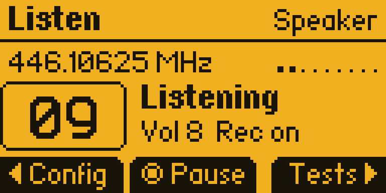
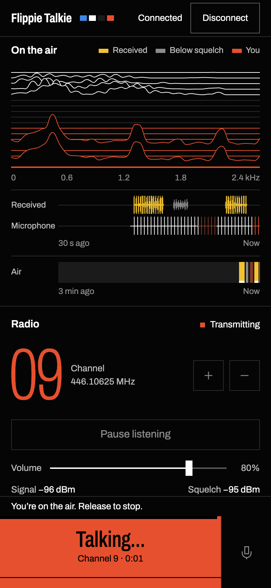
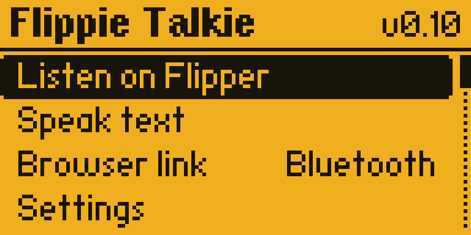
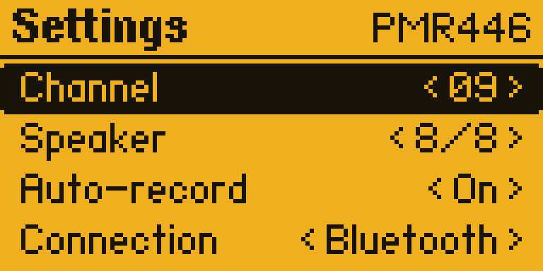
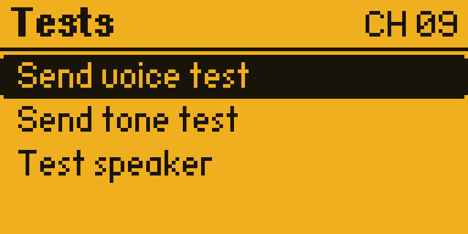
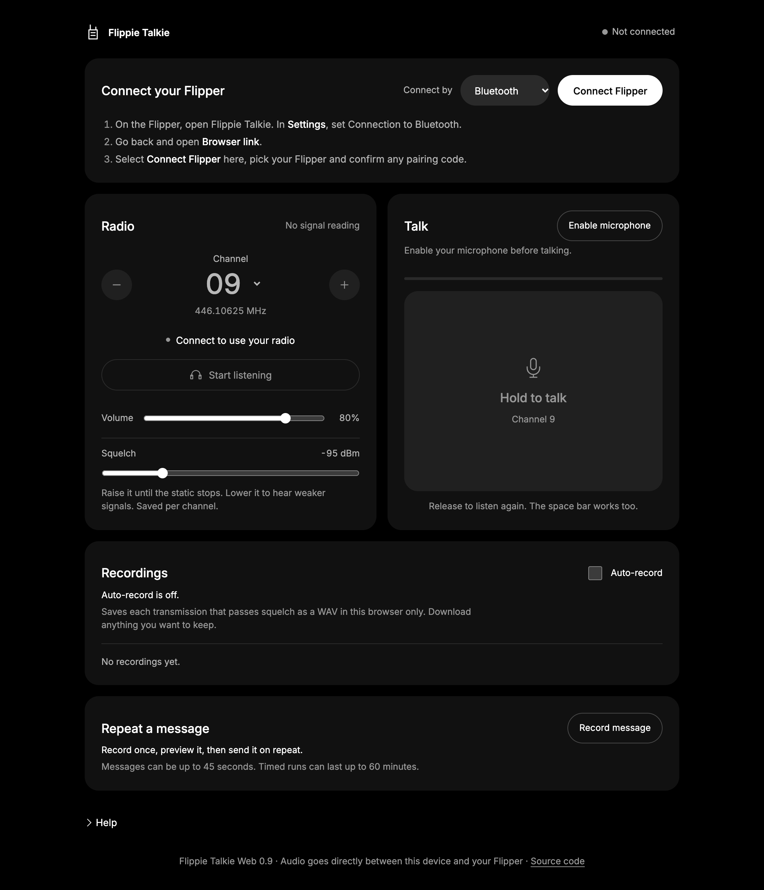
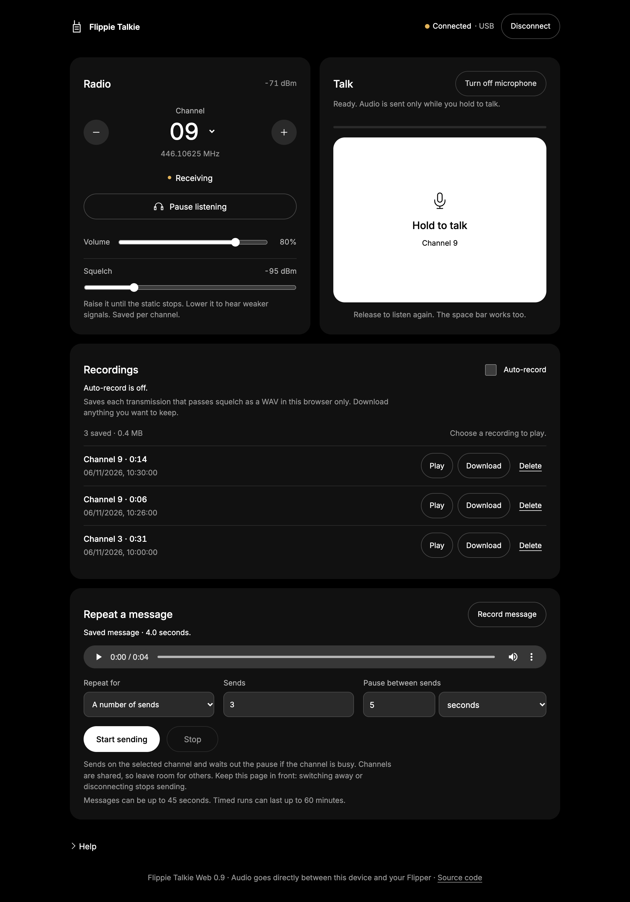

# Flippie Talkie

**Turn a Flipper Zero into a PMR446 walkie-talkie.** Listen through the Flipper's speaker and save what you hear to the SD card, or link it to a browser and talk with your phone or computer microphone.

| On the Flipper | In the browser |
| --- | --- |
|  |  |

> [!WARNING]
> **Check your local radio rules before transmitting.** PMR446 is licence-free only for type-approved radios, and a Flipper Zero isn't one. Using this app to transmit may be illegal where you are, and recording other people's transmissions may be too. You're responsible for how you use it. See [Radio rules](#radio-rules).

## What it does

- **All 16 PMR446 channels**, 446.00625–446.19375 MHz, with a live signal meter.
- **Listen on Flipper:** built-in speaker and automatic WAV recording to the SD card. No computer needed.
- **Speak text:** type a message on the Flipper and it reads it out on the channel, with repeats and a pause. No phone or computer needed. The voice is robotic.
- **Browser link:** connect over Bluetooth or USB, then listen and hold to talk from a web page. Audio goes directly between your browser and the Flipper, with no server in between.
- **Browser extras:** per-channel squelch, recordings saved in your browser, and a recorded message you can send on repeat.
- **Channel tests:** spoken and tone transmissions to check another radio, plus a speaker test.
- **Transmit safeguards:** a busy-channel check, the firmware's frequency restrictions, automatic stop if audio or the connection drops, and a 60-second limit.

Reception is experimental. The Flipper's CC1101 chip isn't an FM receiver, so the app uses it as a slope detector. Speech is recognisable but noisy, and it won't match a real radio. [How it works](docs/HOW-IT-WORKS.md) explains why.

## What you need

- A Flipper Zero with an SD card, running **RogueMaster API 88.23** ([firmware commit `e1837ff`](https://github.com/RogueMaster/flipperzero-firmware-wPlugins/commit/e1837ff6a1a7d5c91a0782343a98e2e600d62da7)). Other firmware needs [its own build](docs/BUILD.md), and the app's Bluetooth code may need changes.
- For Browser link: Chrome on a computer or Android, Edge for USB, or [Bluefy](https://bluefy.app/) on iPhone and iPad. Safari can't connect.
- Another PMR446 radio to talk to. Testing used a Motorola T72.

## Install

This installs an app. It doesn't flash firmware.

1. Exit the app if it's running, and back up any earlier version.
2. Copy [`sd/apps/Sub-GHz/Flippie_Talkie.fap`](sd/apps/Sub-GHz/Flippie_Talkie.fap) to `apps/Sub-GHz/` on the SD card.
3. Copy [`sd/apps_data/pmr_radio/voice/`](sd/apps_data/pmr_radio/voice/) to `apps_data/pmr_radio/voice/`. Keep all 16 `.pdm` files, because the voice test needs them.
4. Open **Apps → Sub-GHz → Flippie Talkie**.

The same files are bundled in [`releases/Flippie-Talkie-v0.10.zip`](releases/Flippie-Talkie-v0.10.zip), with checksums in [`releases/SHA256SUMS`](releases/SHA256SUMS). Settings and recordings from earlier versions carry over.

## Use it on the Flipper

| Home | Settings |
| --- | --- |
|  |  |

Up and Down select a row, OK opens it, and Back returns to Home. In **Settings**, Left and Right change a value. Changes are saved straight away and shared by both modes.

| Setting | Values |
| --- | --- |
| Channel | 1–16 |
| Speaker | 0–8, where 0 mutes the Flipper speaker |
| Auto-record | Save each received transmission as a WAV |
| Connection | Bluetooth or USB, for Browser link |

### Listen on Flipper

Set your other radio to the same channel with its **privacy code off (0)**.

| Listening | Tests |
| --- | --- |
|  |  |

| Button | Action |
| --- | --- |
| OK | Pause or resume listening |
| Up / Down | Speaker volume |
| Left | Config: channel, speaker, auto-record, listening, controls |
| Right | Tests. **Send voice test** and **Send tone test** transmit as soon as you press OK |
| Hold OK | Transmit “Testing channel N” once |
| OK or Back while sending | Stop transmitting |
| Back | Finish any recording and return Home |

Recordings are saved as `apps_data/pmr_voice/chNN_<timestamp>_<tick>.wav`. The timestamp comes from the Flipper's clock, so it's only as accurate as that clock.

## Use it from a browser

| Connect | Connected |
| --- | --- |
|  |  |

The connected views show simulated data, generated by [`tools/web_screenshots.mjs`](tools/web_screenshots.mjs). The Flipper screens are real captures from a device.

1. On the Flipper, set **Settings → Connection**, then open **Browser link**.
2. Open the [hosted web app](https://flippie-talkie.kriss0011.chatgpt.site), or run `npm run serve` and go to <http://localhost:8765>. Phones need HTTPS, so use the hosted app or your own HTTPS host.
3. Choose the same connection, select **Connect Flipper** and confirm any pairing code on the Flipper. Close qFlipper and the Flipper mobile app first.
4. Match the channel and select **Start listening**.
5. Select **Enable microphone**, then hold **Hold to talk** while you speak. The space bar works too.

Keep the page in front. Switching away stops talking and sending, and the browser stops receiving until you come back. Talking is half-duplex: you can't hear while you talk.

On the Flipper, Up and Down change channel, OK pauses or resumes listening and Back disconnects.

## Radio rules

PMR446 is a shared band for short-range voice, licence-free in the EU, the UK and some other countries for approved handheld radios with fixed antennas. Rules differ by country, and the band isn't available everywhere.

- A Flipper Zero has no PMR446 approval. Transmitting with it can break the rules even on a PMR446 frequency.
- This project includes no region unlock. If your firmware blocks a frequency, the app shows “TX blocked” and doesn't transmit.
- Keep transmissions short and leave channels free for other people, especially with repeated messages.
- Laws on recording or sharing other people's radio traffic vary. Listening may be restricted too.

This is experimental software with no warranty. See the [license](LICENSE).

## Limits

- Receive quality is noisy and range is short. Nothing here is a measured range claim.
- Bluetooth carries received audio at 3.2 kHz and USB at 4 kHz; microphone audio goes out at 6 kHz.
- SD writes have stalled and lost samples in the past. That isn't proven fixed.
- Mac Chrome over Bluetooth and USB, and basic iPhone Bluefy use, have been tested. Other platforms and long phone sessions haven't.

Something not working? See [Troubleshooting](docs/TROUBLESHOOTING.md).

## Build from source

```sh
npm test                       # host tests, no hardware or radio involved
python3 tools/verify_bundle.py # check release files against their checksums
bash tools/setup_sdk.sh        # fetch the pinned firmware SDK
bash tools/build.sh            # build into build/sd/
```

The tests need Node.js 20+, a C compiler, FFmpeg and Python 3. There are no npm dependencies. [BUILD.md](docs/BUILD.md) has the details.

## Documentation

- [How it works](docs/HOW-IT-WORKS.md): radio, audio path and safeguards
- [Wire protocol](docs/PROTOCOL.md): Bluetooth and USB framing, for building other clients
- [Build and development](docs/BUILD.md)
- [Troubleshooting](docs/TROUBLESHOOTING.md)
- [Speak text](docs/SPEAK-TEXT.md)
- [Changelog](CHANGELOG.md) and [project history](docs/history/README.md)

```text
firmware/flippie_talkie/  Flipper app
web/                      Browser app: plain ES modules, no build step
sd/                       Ready-to-copy app and voice files
tests/                    Offline tests
tools/                    Build, packaging, capture and diagnostic scripts
docs/                     Guides, screenshots and history
validation/               Reports from device checks
releases/                 Current release and checksums
```

## Contributing

Issues and pull requests are welcome. Start with [CONTRIBUTING.md](CONTRIBUTING.md), and report safety or security problems privately as described in [SECURITY.md](SECURITY.md).

## License

Code is [GPL-3.0](LICENSE). See [third-party notices](THIRD_PARTY_NOTICES.md) for the firmware, the Inter font and the voice prompts.

Flippie Talkie is an independent project, not affiliated with or endorsed by Flipper Devices, RogueMaster or Motorola.
