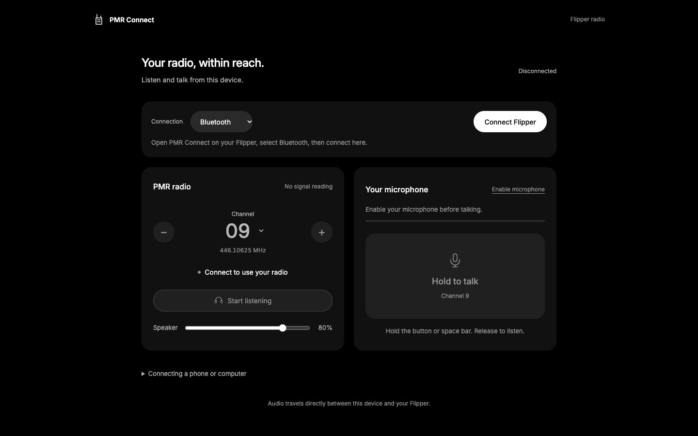

# Flipper PMR Radio

Experimental 16-channel PMR446 radio apps for Flipper Zero: **PMR Connect 0.3** uses a computer/phone as the microphone and speaker over Bluetooth or USB; **PMR Radio 0.17** runs on the Flipper itself with speaker playback, automatic SD WAV recording, and spoken channel tests.

This repository contains the working app sources, installable binaries, web interface, all 16 voice prompts, host tools, validation reports, and the earlier radio experiments and full recordings. It preserves the project as tested on 5 November 2026.



## Start here

| What you want | Use |
| --- | --- |
| Listen and use push-to-talk with a computer or phone | **PMR Connect** + [web interface](https://pmr-connect-dobby.kriss0011.chatgpt.site) |
| Listen through Flipper's built-in speaker, record to SD, or send “Testing channel N” | **PMR Radio** |
| Install both apps without building | Copy the contents of [`sd/`](sd) to the Flipper SD card |
| Compile or change the apps | [Build instructions](docs/BUILD.md) |
| Hear previous tests / inspect raw captures | [`archive/outputs/`](archive/outputs) and [experiment guide](docs/EXPERIMENTS.md) |

See [the v0.3 change and validation report](docs/SMOOTHNESS-0.3.md) for the receive-audio fixes.

The hosted interface is a private ChatGPT Site and requires the owner's sign-in. It is independent of GitHub hosting. You can run the same interface locally or host `web/` yourself.

**Firmware compatibility:** the supplied `.fap` files were built and tested against **Xtreme firmware API 49.2**, commit `6523edcc65af2fa1a72e0dc3b0bb1f9929744877`. They are not universal binaries for current official/Momentum/other firmware. Installing these apps does not require flashing firmware. A different firmware API needs a compatible port/build; the old Xtreme firmware is not a recommendation to replace your current firmware.

## Install on Flipper

1. Download/clone this repository, or use the two packages in [`releases/`](releases).
2. Close the running app on Flipper. Connect USB and open qFlipper's file manager (or use an SD card reader).
3. Copy these files to the matching SD locations. Merge directories; do not replace the whole card:

   ```text
   sd/apps/Sub-GHz/PMR_Connect.fap       -> SD/apps/Sub-GHz/PMR_Connect.fap
   sd/apps/Sub-GHz/PMR_Radio.fap         -> SD/apps/Sub-GHz/PMR_Radio.fap
   sd/apps_data/pmr_radio/voice/ch*.pdm  -> SD/apps_data/pmr_radio/voice/ch*.pdm
   ```

4. Keep all 16 `ch01.pdm` through `ch16.pdm` files for spoken channel tests. Existing recordings and settings can remain in place. Save a copy of an existing app binary before replacing it if you want a rollback.
5. Close qFlipper when using browser USB. Open **Apps → Sub-GHz → PMR Connect** or **PMR Radio** on Flipper. Only one radio app runs at a time.

The equivalent paths in the Flipper CLI begin with `/ext/` instead of `SD/`. The packaged files and archive can be checked with `python3 tools/verify_bundle.py`.

## PMR Connect: Bluetooth listening and push-to-talk

1. Open **PMR Connect** on Flipper. It starts in **Bluetooth**, channel **9**. USB can be unplugged.
2. Open the [hosted interface](https://pmr-connect-dobby.kriss0011.chatgpt.site) or your own copy in a supported browser.
3. Select **Bluetooth → Connect Flipper**, then select your Flipper. The tested device advertises as **Dobby**. The app name does not replace its Bluetooth name.
4. If asked to pair, enter the code currently displayed on Flipper into the computer/phone pairing prompt. A code is not shown for every reconnection.
5. Choose the same channel on both radios. On the Motorola T72, use **privacy code 0/off**. Channel 9 is **446.10625 MHz**.
6. Click **Start listening**. Received audio plays on the computer/phone; adjust **Speaker** volume there.
7. Click **Enable microphone**, allow access, then hold **Hold to talk** while speaking. Release to return to listening. The space bar works on a computer too.
8. Keep the page in the foreground. Disconnect it before switching to another computer/phone. Close the official Flipper mobile app if it is holding the Bluetooth connection.

This is half-duplex: transmitting temporarily stops reception. The host sends microphone audio only while push-to-talk is held. RF transmission stops on missing audio, lost contact, or the 60-second continuous-transmission limit. The page serves static assets; radio/microphone audio travels directly between browser and Flipper, without an audio relay server.

### Browser support

| Device | Connection to try | Project validation |
| --- | --- | --- |
| Mac | Chrome, Bluetooth or USB | Bluetooth listening confirmed by user; transport/USB bench tests passed |
| Windows | Chrome, Bluetooth; Chrome/Edge, USB | Platform capability; not tested here |
| Android | Chrome, Bluetooth | Platform capability; not tested here |
| iPhone / iPad | [Bluefy](https://bluefy.app/), Bluetooth | Basic operation confirmed by the user in Bluefy; v0.3 smoothness retest pending |
| Safari | No direct Web Bluetooth path | Use a compatible browser |

The user has confirmed basic operation in Bluefy on iPhone. Other untested phone/browser combinations are not guaranteed. Chrome documents its supported Web Bluetooth platforms [here](https://developer.chrome.com/docs/capabilities/bluetooth); Bluefy documents its iOS BLE browser [here](https://bluefy.app/).

### USB fallback

1. Connect Flipper by USB and open **PMR Connect**.
2. Press **OK on Flipper** to switch from Bluetooth to **USB**.
3. In desktop Chrome/Edge, select **USB → Connect Flipper** and choose the Flipper serial port.
4. Use the same listening and push-to-talk controls. Close any other serial client first.

On Flipper, **Left/Right** selects a channel, **OK** changes transport, and **Back** exits. Changing transport stops the active session; reconnect in the browser.

### Run the web interface locally

From the repository root:

```sh
python3 -m http.server 8765 --bind 127.0.0.1 --directory web
```

Open **http://localhost:8765** in Chrome on that same computer. No npm install or web build is required. Do not open `index.html` directly with `file://`.

For a phone, put the contents of `web/` on an HTTPS static host. An ordinary `http://192.168...` LAN address does not provide the secure browser context required by microphone/Bluetooth APIs. The host must serve JavaScript modules normally and allow microphone/Bluetooth permissions. No backend, API key, or deployment token is needed by this app. Hosting public web assets would expose the interface source even while this GitHub repository remains private; choose hosting access intentionally.

## PMR Radio: standalone speaker and SD recordings

Open **Apps → Sub-GHz → PMR Radio**. It works with USB unplugged.

| Control | Action |
| --- | --- |
| Left / Right | Choose channel 1–16, one at a time |
| Up / Down | Speaker volume 0–8; 0 mutes |
| Hold OK on the main screen | Transmit “Testing channel N” once |
| Tap OK | Recording, pause/resume, voice/tone test, and help menu |
| OK during reception | Finish the current receive and pause |
| OK or Back during transmission | Stop transmitting |
| Back on main screen | Finish recording and exit |

Enable **Auto-record** in the menu to save received transmissions as full WAV files, with no fixed four-second recording window:

```text
SD/apps_data/pmr_voice/chNN_<timestamp>_<tick>.wav
```

After exiting the app, download WAVs with qFlipper's file manager. Any normal audio player can play them. The device's clock was incorrect during the experiments, so old filename timestamps are not reliable dates. Channel, volume and recording preferences are retained in `SD/apps_data/pmr_radio/settings.bin`.

Version 0.17 restores the earlier, quieter speaker mapping: additional compression and treble boost were removed. Turning up the speaker cannot recover information missing from the RF reception. **PMR Connect does not currently record to SD or play through the Flipper speaker**; use PMR Radio for those functions.

## What works, and what is still experimental

- All 16 analogue PMR446 channels are selectable: `446006250 + (channel - 1) * 12500` Hz. The Motorola T72 test used channel 9, privacy code off.
- The spoken channel-9 transmission was reported clear on the Motorola, including a test three floors away. This is a user-reported result, not a measured range specification.
- Reception uses the CC1101's RSSI response as an experimental FM slope detector. It is noisy and is not equivalent to a purpose-built narrowband FM receiver or SDR with IQ samples. Software filtering has not produced consistently clear long-range reception.
- Receive audio is 3.2 kHz mono over Bluetooth and 4 kHz over USB; microphone transmit audio stays at 6 kHz. Version 0.3 reduces Bluetooth load and uses a continuous playback buffer (about 240 ms) to tolerate phone delivery jitter instead of repeatedly clearing scheduled audio.
- Version 0.3 BLE capacity test: 80/80 representative audio-size packets, no drops. The earlier 0.2 test delivered 99/99 at its higher rate. Streaming transmit test: no underflow while audio was flowing; deliberately omitting STOP shut RF down approximately 0.51 seconds after the last host write. See [validation](docs/VALIDATION.md).
- One standalone SD write stalled for about a second and lost samples. A repeat check passed. That intermittent storage issue is **not proven fixed**.
- The user reported that iPhone/Bluefy works but v0.2 reception cuts briefly every few seconds. Version 0.3 addresses transport load, playback resets and unnecessary carrier rechecks; sustained iPhone listening with this update still needs confirmation. A desktop transport bench is not a phone/range test.

The apps retain the firmware's transmit-frequency permission check. This project does not modify regional restrictions.

## Develop and verify

Requirements for host tests: Node.js 20+, a C compiler (`cc`), FFmpeg, and Python 3. Run from the repository root:

```sh
npm test
python3 tools/verify_bundle.py
```

`npm test` checks C/JavaScript codec agreement, independent FFmpeg decoding, fragmented packets, microphone resampling, all 16 voice assets, finite tone/voice timing, recurring delivery stalls, clock drift and receiver squelch behavior. These are offline tests and do not transmit. `CC` and `FFMPEG` may name alternative executable paths.

To build both Flipper apps:

```sh
bash tools/setup_sdk.sh
bash tools/build.sh
```

Fresh binaries land in `build/sd/apps/Sub-GHz/`. Copy them using the same installation procedure. [Build instructions](docs/BUILD.md) cover dependencies, existing SDK checkouts, voice generation and the archive. [Troubleshooting](docs/TROUBLESHOOTING.md) covers pairing, disconnects, silence and recording issues. [Protocol documentation](docs/PROTOCOL.md) describes the transport for another client.

## Repository map

```text
firmware/pmr_connect/   Bluetooth/USB Flipper app, v0.3
firmware/pmr_capture/   Standalone PMR Radio app, v0.17 (historical internal name)
web/                   Self-contained browser interface
sd/                    Ready-to-copy apps and all 16 spoken-channel assets
tools/                 Portable build, verification, voice and audio tools
tests/                 Offline C/JavaScript tests and short speech fixture
docs/                  Build, protocol, troubleshooting, experiment and validation guides
validation/            Original final hardware/transport validation reports
assets/                Voice prompt manifest and WAV previews
releases/              Original packaged releases and checksums
archive/work/          Earlier scripts, app revisions and experiment data
archive/outputs/       Earlier full recordings, calibrations and delivered results
archive/manifest.json  SHA-256 integrity inventory of the historical archive
```

The archive is historical evidence, not the recommended installation source. Some old scripts contain original local paths or device-specific assumptions; see its guide before running them. Downloaded firmware/toolchains, virtual environments, credentials, hosting deployment state, and unrelated personal NFC/RFID/Sub-GHz backups are intentionally not stored here.

Code is provided under [GPL-3.0](LICENSE); see [third-party notices](THIRD_PARTY_NOTICES.md) for the firmware base, font and reference projects. Captured speech and test media remain project data; the code license does not grant third-party voice or media rights.
