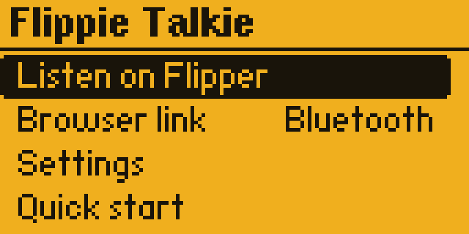

# Flippie Talkie

**One native Flipper Zero PMR446 app:** built-in speaker, automatic SD WAV recording, spoken channel tests, Bluetooth/USB browser audio, and browser microphone push-to-talk.

Version **0.5** merges the former Flippie Talkie and Flippie Talkie Radio into one application. Open **Apps → Sub-GHz → Flippie Talkie**. Its home menu offers **Listen on Flipper**, **Browser link**, **Settings**, and **Quick start**. Settings are shared across both modes and survive restarting the app. The previous eight-byte radio settings are migrated automatically.



## Install

The supplied app targets **Xtreme API 49.2**, firmware commit `6523edcc65af2fa1a72e0dc3b0bb1f9929744877`. Other firmware APIs need a compatible build. This installs an app; it does not flash firmware.

1. Back up your existing app binaries and `SD/apps_data/pmr_radio/settings.bin`.
2. Exit the running app. Copy [`sd/apps/Sub-GHz/Flippie_Talkie.fap`](sd/apps/Sub-GHz/Flippie_Talkie.fap) to the same location on the SD card.
3. Merge [`sd/apps_data/pmr_radio/voice/`](sd/apps_data/pmr_radio/voice/) into the same SD directory. Keep all 16 `.pdm` files for spoken tests.
4. Remove the obsolete **Flippie_Talkie_Radio.fap**, **PMR_Connect.fap**, and **PMR_Radio.fap** menu entries after backing them up. Keep existing voice assets and recordings.

The current `firmware/`, `sd/`, build script and release package contain one app. `archive/` retains historical experiments and original release evidence; those files are not installation sources.

## Home and settings

Use **Up/Down** to select a row and **OK** to open it. **Back** returns to Home from either radio mode; **Back on Home** exits the application.

In **Settings**, use **Left/Right** to change:

| Setting | Values |
| --- | --- |
| Channel | All 16 PMR446 channels |
| Speaker | 0–8; 0 mutes the Flipper speaker |
| Auto-record | Save received transmissions as WAVs, on/off |
| Connection | Bluetooth or USB for browser audio |

Settings save to `SD/apps_data/pmr_radio/settings.bin`. An SD error is shown if saving fails. Browser mode uses the computer/phone microphone and speaker; the standalone mode uses the Flipper speaker and SD recorder.

## Listen on Flipper

Match the channel on both radios. Use **privacy code 0/off** on the other radio. Channel 9 is **446.10625 MHz**.

| Control | Action |
| --- | --- |
| Left: Config | Channel, speaker volume, auto-record, listening and controls |
| OK | Pause/resume listening; finish the current receive when paused |
| Right: Tests | Spoken channel test, rising tone test, built-in speaker test |
| Up/Down | Speaker volume |
| Hold OK on listening screen | Send “Testing channel N” once |
| OK or Back during transmission | Stop transmission |
| Back | Finish recording and return Home |

During a receive, **OK pauses**, **Up/Down changes volume**, and **Back saves and returns Home**. Open Config or Tests after reception finishes or after pausing. Settings and test menus stay visible when a carrier arrives.

Auto-record saves full received transmissions, without a fixed four-second window:

```text
SD/apps_data/pmr_voice/chNN_<timestamp>_<tick>.wav
```

Download WAVs after leaving the mode. The device clock was wrong during earlier experiments, so historical filename timestamps are not reliable dates.

## Browser link: Bluetooth / USB

1. Choose Bluetooth or USB in **Settings → Connection**.
2. Open **Browser link** on Flipper.
3. Open the [web interface](https://flippie-talkie.kriss0011.chatgpt.site), or run `npm run serve` and open **http://localhost:8765** in Chrome on the same computer.
4. Select the same transport in the browser, then **Connect Flipper**. The tested device advertises as **Dobby**. Enter the Flipper pairing code if requested.
5. Match the channel, click **Start listening**, and adjust the browser speaker volume.
6. Enable the microphone, then hold **Hold to talk** while speaking. Release to listen again. Desktop space bar also works.

On Flipper, **Left opens Config**, **Right opens connection help**, **Up/Down changes channel**, and **OK pauses/resumes listening when connected**. During microphone transmission, OK stops it. Config contains channel, connection type and listening. Changing transport ends the browser session; reconnect using the new transport. Back returns Home and disconnects the session.

Close qFlipper, the official mobile app, and other serial clients when using the browser connection. Keep the browser page in the foreground. Mac Chrome Bluetooth/USB and basic iPhone Bluefy operation were previously checked; other platforms and sustained phone performance remain unverified. Safari has no direct Web Bluetooth path. The hosted interface requires the owner's ChatGPT Site sign-in. The web interface is unchanged by the native redesign.

The app is half-duplex. It transmits browser microphone audio only while push-to-talk is held, with loss-of-contact and missing-audio shutoffs and a 60-second continuous-transmission limit. Audio travels directly between browser and Flipper. Firmware transmit-frequency restrictions remain enforced.

## Experimental reception

The CC1101 is used as an experimental FM slope detector. Reception is noisy and does not match a dedicated narrowband FM radio. Software cannot recover speech absent from RF reception. Speaker processing and browser audio algorithms are retained from the earlier versions: Bluetooth receive audio is 3.2 kHz, USB receive audio 4 kHz, microphone transmit audio 6 kHz.

Earlier SD writes occasionally stalled and lost samples; that issue is not proven fixed. Earlier user-reported range and phone tests are historical results. The 0.5 UI/merge checks do not establish new audio quality, RF range, or phone performance. See [redesign validation](docs/REDESIGN-0.5.md) and [earlier audio validation](docs/SMOOTHNESS-0.3.md).

## Build and verify

```sh
npm test
python3 tools/verify_bundle.py
bash tools/setup_sdk.sh
bash tools/build.sh
```

The build produces one `build/sd/apps/Sub-GHz/Flippie_Talkie.fap`. See [build instructions](docs/BUILD.md). Offline tests require Node.js 20+, a C compiler, FFmpeg, and Python 3. No npm dependencies are needed.

```text
firmware/flippie_talkie/ Unified app, shared settings and native UI
web/                    Browser microphone/speaker interface
sd/                     One installable app + 16 voice assets
releases/               Current unified release and checksums
validation/redesign-0.5/ Actual USB screen captures and checks
archive/                Historical experiments and original evidence
```

Code is [GPL-3.0](LICENSE); see [third-party notices](THIRD_PARTY_NOTICES.md). Historical recordings and voice assets remain project data with their existing provenance.
