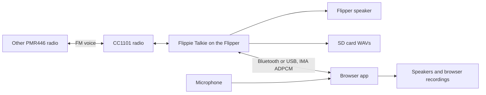

# How it works

Flippie Talkie makes analog voice work on hardware that wasn't built for it. The Flipper's CC1101 is a digital packet radio with no audio demodulator or modulator, so both directions are workarounds.

## Channels

The 16 channels sit 12.5 kHz apart, starting at 446.00625 MHz. Channel 9 is 446.10625 MHz.

## Receiving

The CC1101 can't output FM audio, but it does report signal strength (RSSI). The app tunes slightly off the channel, so the transmission sits on the slope of the receive filter. As the FM signal swings in frequency, it moves up and down that slope and the signal strength rises and falls with the speech. This is called slope detection.

The app samples RSSI at 8 kHz, filters it and resamples it to 3.2 kHz for Bluetooth or 4 kHz for USB. Getting recognisable speech out of this depended on sample timing, filter state and tuning. It stays noisy, and software can't recover speech that never reached the radio.

## Transmitting

The radio has no analog FM input either. The app turns audio into a stream of one-bit pulses at a nominal 48 kHz (pulse-density modulation) and uses it to switch the CC1101's FSK output between two frequencies, which averages out to frequency-modulated voice.

Microphone audio passes through a 200 Hz–2.4 kHz band-pass filter in the browser, then goes to the Flipper at 6 kHz. The Flipper opens with **500 ms of silent carrier**, because the other radio takes a moment to open its speaker. Your opening words wait in a buffer during that time. When you release, the buffer finishes sending before the app goes back to listening.

Stored voice tests are the same kind of one-bit audio, generated ahead of time by `tools/generate_voice.py` and stored as `.pdm` files.

## The browser link

Audio travels as 164-byte IMA ADPCM blocks of 321 samples, which fit the measured Bluetooth throughput. The browser decodes received blocks and uses a small playback buffer to ride out timing jitter. Bluetooth writes use the firmware's serial service with its credit-based flow control, and USB uses the Flipper's serial port after a short CLI handshake. [PROTOCOL.md](PROTOCOL.md) has the details.

Everything stays local. The web app is static files, and there's no server, account or upload. Recordings live in the browser's IndexedDB and squelch settings in local storage.

**The display** is drawn from that same audio, so it shows noise as faithfully as speech. `web/air-history.js` slices received and microphone audio into 50 ms columns and runs a 256-point FFT on each, on one 0–2.4 kHz axis, so the different sample rates line up. Frequencies above a link's limit stay empty: Bluetooth tops out at 1.6 kHz. `web/pulse-field.js` draws the columns as a stacked pulse field, waveform lanes and the air timeline. The microphone view reads a separate analyser branch, so the display can't affect what gets transmitted.

**Squelch** runs in the browser and works from the RSSI the Flipper reports, with 4 dB of hysteresis and a 450 ms hold. It decides what you hear and what gets recorded, but it can't tell strong interference from a wanted signal.

## Transmit safeguards

Every transmission has to pass these checks:

| Safeguard | Behaviour |
| --- | --- |
| Firmware frequency check | No transmission if the firmware doesn't allow the frequency |
| Busy check | No transmission while the channel is occupied |
| Push-to-talk only | The browser sends audio only while talk is held or a repeat is running |
| Missing audio | Stops after about 400 ms without audio |
| Lost contact | Stops after about 1.5 s without the browser |
| Time limit | Stops after 60 seconds of continuous transmission |
| Page in background | The browser stops talking and repeats when the page loses focus |

## Code map

| File | Purpose |
| --- | --- |
| `firmware/flippie_talkie/flippie_talkie.c` | Home menu, settings, app entry point |
| `firmware/flippie_talkie/pmr_speak.c`, `pmr_tts.c` | Speak text: a plugin with text-to-speech, the transmit loop and speaker preview. See [Speak text](SPEAK-TEXT.md). |
| `firmware/flippie_talkie/pmr_capture.c` | Listen on Flipper: receive, speaker, SD recording, tests |
| `firmware/flippie_talkie/pmr_connect.c` | Browser link: transports, streaming, push-to-talk |
| `firmware/flippie_talkie/pmr_ui.h` | Shared 128 × 64 screen layout |
| `firmware/flippie_talkie/pmr_radio_core.h` | Channel plan and transmit timing |
| `web/app.js` | Connection, radio state and push-to-talk |
| `web/air-history.js`, `web/pulse-field.js` | Audio analysis and the live display |
| `web/receiver.js`, `web/playback-buffer.js` | Squelch, recording and playback buffering |
| `web/transports.js`, `web/codec.js` | Bluetooth, USB, framing and ADPCM |
| `web/messages.js`, `web/broadcast.js` | Recorded messages and repeats |

The [project history](history/README.md) records how these designs were reached.
