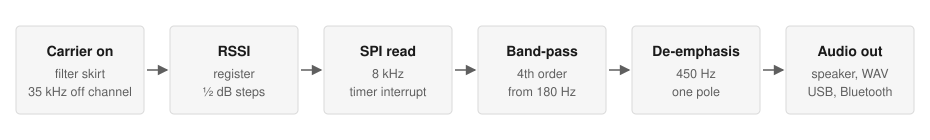
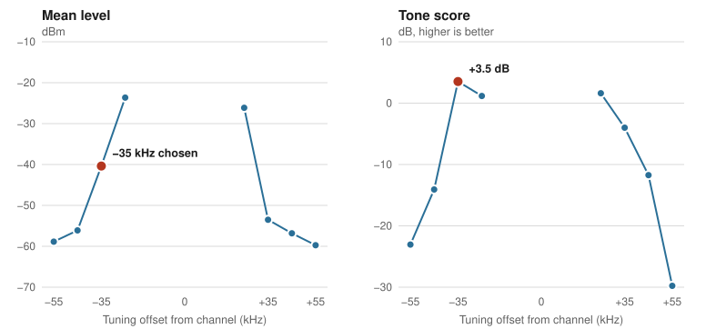

# Receiving analog FM voice on a digital packet radio: RSSI slope detection on the CC1101

**Kristiyan Dobrev**, Flippie Talkie project, November 2026

Informal technical report. Not peer reviewed. Source code: <https://github.com/kriss0011/flippie-talkie>

## Abstract

The Texas Instruments CC1101 in the Flipper Zero is a digital packet transceiver. It has no analog FM demodulator and no audio output, and public discussion has generally treated voice reception on it as impractical. This report describes a working receiver for PMR446 narrowband FM voice that needs no hardware changes. The radio is tuned 35 kHz away from the channel, so the carrier sits on the skirt of its narrowest (58 kHz) channel filter. Frequency modulation then becomes a change in received level. The chip's RSSI status register is read over SPI at 8 kHz from a timer interrupt, and the readings are band-pass filtered and de-emphasised into audio.

Test tones of 500, 1000 and 2000 Hz sent from a Motorola T72 were recovered at the correct frequencies, peaking 31 to 35 dB above nearby noise. The RSSI path outperformed the chip's one-bit data output in a direct comparison. Speech is recognisable by ear but noisy. No formal intelligibility test has been done, and all results come from one Flipper and one transmitter. We found no earlier public example of voice reception on this hardware, although a search cannot prove that none exists.

## 1. Introduction

Flippie Talkie turns a Flipper Zero into a PMR446 walkie-talkie. Transmitting FM from the CC1101 can be done by switching its FSK output quickly, and this had been shown before. Receiving is harder. The chip's demodulator decides between two frequencies and outputs bits. It doesn't output a voltage that follows the audio, so nothing on the chip directly gives you the voice waveform.

The chip does report one continuously varying quantity: received signal strength. This report shows that this is enough to recover speech, explains the settings that made it work, and sets out how far the evidence goes.

The technique isn't new. Slope detection is a classic way to receive FM on a receiver with no FM detector [5, 6]. What appears to be new is applying it to a packet radio's digital RSSI register, fast enough to carry voice.

## 2. Background

**The signal.** PMR446 uses analog narrowband FM on 16 channels, 12.5 kHz apart, from 446.00625 to 446.19375 MHz, with a peak deviation of about ±2.5 kHz. Radios typically apply pre-emphasis, so higher audio frequencies are sent with more deviation.

**The radio.** Four CC1101 properties matter here [1]:

- The narrowest channel filter is 58 kHz, more than four times wider than a PMR446 channel.
- RSSI is an estimate of signal power in the channel, read from a status register, in dBm with ½ dB resolution.
- RSSI can be read continuously in receive mode unless sync word detection freezes it.
- The RSSI update rate is `f_RSSI = 2 × BW_channel / (8 × 2^FILTER_LENGTH)`.

With a 58 kHz filter and `FILTER_LENGTH` set to 0, the update rate is about 14.5 kHz. That is fast enough for voice, and this calculation is what makes the method plausible at all. A wider filter would update faster but make the skirt less steep relative to the deviation. A longer RSSI filter averages more but updates more slowly, at 7.25 kHz for the next setting.

**Slope detection.** A receiver is tuned slightly off the carrier, so the signal sits on the sloped side of a filter. As the frequency swings with the audio, the signal moves up and down that slope, and its level follows the audio [5, 6]. The usual drawbacks are distortion, because the slope isn't straight, and sensitivity to any amplitude change in the signal.

## 3. Prior work

We searched on 6 November 2026, using web searches, the Flipper community forum and project pages. GitHub repository search returned no results for these terms, so it adds no evidence either way.

| Work | Approach | Voice received on the CC1101? |
| --- | --- | --- |
| Flipper forum NFM idea [2] | Retune rapidly across nearby frequencies and rebuild the spectrum from RSSI | No. Never built. The poster estimated about 133 Hz of audio sampling and concluded the hardware probably couldn't do it |
| Radio Scanner [3] | Mirrors the 2-FSK data output to the speaker while scanning | Not claimed. It makes received signals audible, with no stated voice result |
| Walkie Talkie (Flipper app catalogue) [4] | Described in a community list as a receive-only FRS activity and RSSI scanner | Not as far as we can tell. We couldn't load the catalogue page to confirm this |
| FMTX [7] | One-bit PDM switching between two FSK states | No. Transmit only |
| APRS transmitter [8] | Bell 202 tones sent from the CC1101 | No. Transmit only |
| HackRF with PortaPack | Separate SDR hardware with true FM demodulation | Yes, but this isn't the CC1101 |

So we found no earlier public example of voice reception with the CC1101, on the Flipper or elsewhere. Unpublished work, or work in sources our searches missed, may exist. Corrections are welcome.

The forum proposal failed because each measurement needed a retune, reported there as 75 µs. Our method stays on one frequency, so that limit doesn't apply. The filter's slope does the work of comparing frequencies.

## 4. Method

### 4.1 Radio configuration

The receiver starts from the firmware's internal 2-FSK preset and overrides five registers, then tunes 35 kHz below the channel.

| Register | Value | Effect |
| --- | --- | --- |
| `MDMCFG4` | `0xFA` | Channel filter 26 MHz / (8 × 7 × 2³) = 58 kHz, the narrowest available |
| `FOCCFG` | `0x00` | Frequency offset compensation off, so the chip can't track the signal back to centre |
| `MDMCFG2` | `0x00` | 2-FSK, no sync word, so RSSI is never frozen |
| `AGCCTRL2` | `0x03` | Gain target 33 dB, with maximum gain unrestricted |
| `AGCCTRL0` | `0x90` | `FILTER_LENGTH` 0, the fastest RSSI update |

Frequency compensation is off because the chip would otherwise work against the deliberate offset.

### 4.2 Sampling

A hardware timer interrupt reads RSSI at 8 kHz with a direct two-byte SPI transaction, limited to 32 µs so a faulty radio can't hang the interrupt. The app owns the SPI bus while sampling. Early versions reached about 6.8 kHz in practice, with gaps of up to about 3 ms. In a later 16-stage bench test the timer version took 359,093 samples with none dropped, and the longest gap between samples was 0.135 ms, against a nominal 0.125 ms.

Sampling at 8 kHz is not synchronised with the roughly 14.5 kHz RSSI update, and there is no anti-alias filter before sampling apart from the chip's own averaging. Some aliasing is therefore likely.

### 4.3 From RSSI to audio

Each reading is converted to decibels and goes through the chain in Figure 1.

*Figure 1. Receive signal chain. The filters run in the sampling interrupt on the Flipper's processor.*

The steps are:

1. Subtract the first reading as a baseline, which removes the large fixed level.
2. Apply a fourth-order Butterworth band-pass filter. The pass band is 180–2600 Hz for the Flipper's speaker and WAV recordings, 180–1700 Hz for USB and 180–1400 Hz for Bluetooth.
3. Apply a one-pole 450 Hz de-emphasis filter to undo the transmitter's pre-emphasis.
4. Apply fixed gain and clip to 16 bits, with a 10 ms fade-in. Stronger, nonlinear gain was tried and removed, because it made the noise objectionable.
5. For the browser link, resample to 4 kHz (USB) or 3.2 kHz (Bluetooth) and encode as IMA ADPCM.

All of this is plain filtering of what the radio measured. Nothing is synthesised or guessed, so the output can't contain speech that never reached the radio.

### 4.4 Detecting the carrier

Because the receiver is off-channel, RSSI there can't reliably show whether a transmission has ended. A carrier can even read lower than the noise it replaces. The app therefore waits on the channel centre, requires a level above a threshold set from the measured noise floor, and only then moves to the offset. While receiving, it learns the offset level of the confirmed carrier and returns to the centre for a brief check only when that level changes. An earlier fixed threshold caused repeated retunes and audible cuts on stable carriers.

## 5. Results

All tests used a Flipper Zero and a Motorola T72 on channel 9 (446.10625 MHz) on 5 November 2026. The synthesiser's actual setting was 446.10614 MHz. The tests used early builds on Xtreme firmware. The current app runs on RogueMaster with the same receive settings, but these measurements haven't been repeated on it. The numeric results are in [`data/`](data/). The raw captures aren't published because some of them contain private test speech.

### 5.1 Tones survive the path

A 17-second track of 500, 1000 and 2000 Hz tones separated by silence was transmitted with the receiver tuned 25 kHz off the channel. After timestamp-based resampling, all three tones appeared at exactly their transmitted frequencies and in the expected time windows. Tone amplitude was 4 to 10 times higher than in the silent gaps. A carrier with no audio showed no peak above about 11.5 dB in any of the three bands. With tones present, the peaks reached 31 to 35 dB.

### 5.2 RSSI compared with the one-bit data output

The chip's data output is the obvious first choice, since it comes from the real FSK demodulator. Both signals were recorded together in the same capture.

| Tone | RSSI peak above noise | Data pin peak above noise | RSSI median | Data pin median |
| --- | --- | --- | --- | --- |
| 500 Hz | 31.4 dB | 15.8 dB | 8.4 dB | 2.5 dB |
| 1000 Hz | 32.5 dB | 24.2 dB | 8.2 dB | 1.0 dB |
| 2000 Hz | 34.7 dB | 29.5 dB | 7.2 dB | 3.8 dB |

*Table 1. Tone level above nearby noise across short analysis windows in one 16.6-second capture. Medians include windows with no tone.*

RSSI was ahead at every tone, by the widest margin at low frequencies, where most speech energy is. In an earlier voice test the data pin stayed high for most of the reception. Early captures from this path didn't yield usable speech, and that decided the design. This comparison is from one capture with an early preset, so it doesn't rule out a better-tuned one-bit receiver.

### 5.3 Choosing the offset

Sixteen settings were swept during one continuous transmission of 503, 997 and 1999 Hz played together, about 2.2 seconds per setting. Each was scored by fitted tone power against residual noise and distortion. Figure 2 shows the eight settings that differ only in offset.

*Figure 2. Effect of tuning offset, from one sweep. Left: mean level. Right: tone score. Higher is better, and the score measures tone recovery, not speech quality.*

Three things stand out:

- **The working point is narrow.** The score peaks at −35 kHz (+3.5 dB) and falls to −14 dB at −45 kHz. Closer in, at ±25 kHz, the 2 kHz tone moved RSSI by only 0.35 to 0.56 dB, against 1.73 dB at −35 kHz. Further out, the signal is too weak.
- **The skirt is close to straight in decibels.** Between −25 and −45 kHz the level falls 16.8 dB and then 15.7 dB per 10 kHz, or about 1.6 dB per kHz. RSSI reports decibels, so a straight skirt in decibels gives output close to linear in frequency. This may reduce the classic slope-detector distortion, though three points from one sweep can't confirm it.
- **The two sides differ.** −35 kHz read −40.4 dBm and +35 kHz read −53.5 dBm. One explanation is a combined frequency error of about 4 kHz between the two radios, or about 9 ppm. We haven't verified this.

Other settings mattered less. A longer RSSI filter at −35 kHz scored 2.0 dB. Frozen gain at −35 kHz scored within 0.011 dB of automatic gain, so automatic gain was kept to handle changing signal levels. OOK-mode RSSI at −35 kHz scored lower, at −0.5 dB.

Tone amplitude also rose with frequency at the chosen setting: 0.29, 0.79 and 1.73 dB at 503, 997 and 1999 Hz. That is roughly a doubling per octave, consistent with transmitter pre-emphasis and with the need for the de-emphasis stage.

**What this implies for resolution.** At 1.6 dB per kHz, a full ±2.5 kHz swing moves RSSI by about ±4 dB. With ½ dB steps, that is about 16 levels from peak to peak, or roughly 4 bits at full deviation and fewer for quieter speech. This estimate likely explains much of the noise floor, and no filter can restore the lost detail.

### 5.4 Interference from recording

Early speech captures had loud recurring pulses. They lined up with the 2048-sample blocks written to the SD card.

| Recording path | RSSI excursion near block boundaries | Away from boundaries | Ratio |
| --- | --- | --- | --- |
| SD card | 5.48 dB | 1.07 dB | 5.14 |
| USB, capture 1 | 1.01 dB | 0.92 dB | 1.10 |
| USB, capture 2 | 1.12 dB | 1.09 dB | 1.03 |

*Table 2. RSSI residual, after removing a local trend, near and away from recording block boundaries.*

Streaming over USB removed the pattern, which ties it to the recording process. These captures don't show whether the path was electrical or caused by timing, and later bench captures with a newer recorder measured ratios of 0.98 to 0.99. This matters generally: the RSSI register is a sensitive measurement, and activity elsewhere on the board can appear directly in the audio.

### 5.5 Speech

Speech from the T72 was heard and recognised by the author, on the Flipper and in a browser. It is noisy and doesn't match a real radio. This is a listening report only. No words were formally transcribed and no intelligibility score was measured.

### 5.6 Distance

Informal use has worked up to about 100 m in both directions. This is not a calibrated range measurement, as it depends on the antenna, surroundings and radios. In one two-room test at low signal level, an earlier version broke the transmission into 23 fragments, which led to the carrier logic in section 4.4. Sensitivity hasn't been measured.

## 6. Transmitting

Transmit uses the reverse idea and isn't new here [7]. Audio is converted to a one-bit pulse-density stream at a nominal 48 kHz, which switches the CC1101 between two FSK frequencies at ±2.38 kHz. The receiver's filter averages these into a smooth frequency swing. The app adds 500 ms of silent carrier before speech, because the T72 otherwise cut off the first word, and a firmware timing correction was needed so that voice didn't run about 5% fast. Radiated power and spectral purity haven't been measured.

## 7. Limitations

- **One device pair.** Everything comes from one Flipper and one Motorola T72. Each 1 ppm of crystal error is 446 Hz at this frequency, so −35 kHz may not be the best offset for another pair.
- **No intelligibility measurement.** The tone score isn't a speech quality score.
- **Short, single sweep.** Each setting had about 2.2 seconds, and the sweep ran once. The repeated baseline setting moved 10 dB in level and 1.1 dB in score over the sweep. Differences of about 1 dB between settings therefore don't mean much. The cause of the drift wasn't established.
- **No sensitivity, range or distortion figures.** No signal generator or calibrated instrument was used.
- **Older builds.** The measurements predate the current firmware port.
- **Amplitude sensitivity.** Fading and interference change RSSI just as modulation does, so they appear in the audio as noise.
- **Co-channel and adjacent signals.** A 58 kHz filter spans several 12.5 kHz channels, so nearby transmissions can reach the receiver. This wasn't tested.

## 8. Future work

- Measure intelligibility with a standard method, using consenting speakers and several radios.
- Measure sensitivity and distortion with a signal generator.
- Add automatic offset calibration for each device, to correct crystal error.
- Combine RSSI with the one-bit output, or test whether oversampling RSSI closer to its 14.5 kHz update rate reduces noise.
- Test whether the method carries over to other radios with a fast RSSI register.

## 9. Reproducing this work

The firmware, DSP and tools are in the repository, and the receive path is in `firmware/flippie_talkie/pmr_connect.c`, `pmr_capture.c` and `pmr_link_dsp.h`. You need a Flipper Zero and a second PMR446 radio. Listening needs no firmware changes. Transmitting is restricted by the firmware and by law. PMR446 is licence-free only for type-approved radios, which a Flipper Zero isn't, so check your local rules first. Recording other people's transmissions may also be illegal where you are.

## Acknowledgements

Claude, an AI assistant from Anthropic, helped write the firmware and analysis tools and drafted this report from the project's code and test records. Measurements and listening tests were carried out by the author.

## References

1. Texas Instruments. *CC1101 Low-Cost Low-Power Sub-1GHz RF Transceiver*, SWRS061C. <https://www.usconverters.com/downloads/datasheets/cc1101.pdf>
2. *[Silly] App idea: NFM radio*. Flipper community forum. <https://forum.flipper.net/t/silly-app-idea-nfm-radio/23833>
3. RocketGod. *Flipper Zero Radio Scanner*. <https://github.com/RocketGod-git/Flipper-Zero-Radio-Scanner>
4. *Walkie Talkie*, Flipper app catalogue <https://lab.flipper.net/apps/walkie_talkie>, as described in *flipper-zero-awesome* <https://github.com/123fzero/flipper-zero-awesome>
5. *FM Slope Detector / Demodulator*. Electronics Notes. <https://electronics-notes.com/articles/radio/modulation/fm-frequency-demodulation-slope-detector-discriminator.php>
6. *Slope detection for FM demodulation*. EDN. <https://www.edn.com/slope-detection-for-fm-demodulation/>
7. YO3GND. *FMTX*. <https://github.com/yo3gnd/fmtx>
8. *Bending the Flipper Zero's CC1101 Into an APRS Transmitter*. RTL-SDR.com. <https://www.rtl-sdr.com/bending-the-flipper-zeros-cc1101-into-an-aprs-transmitter/>
